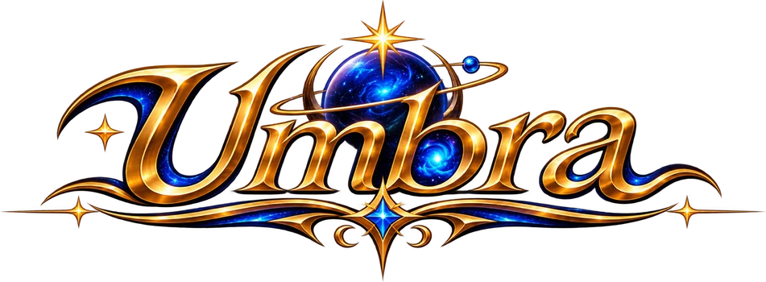
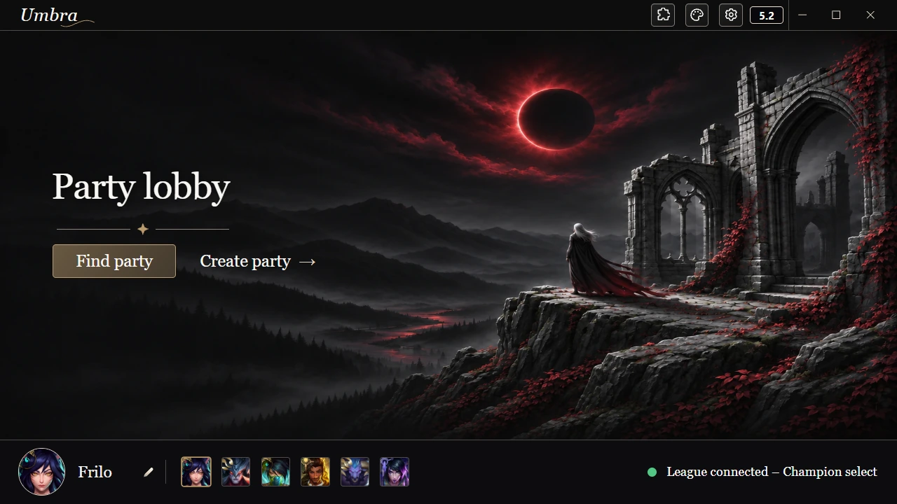
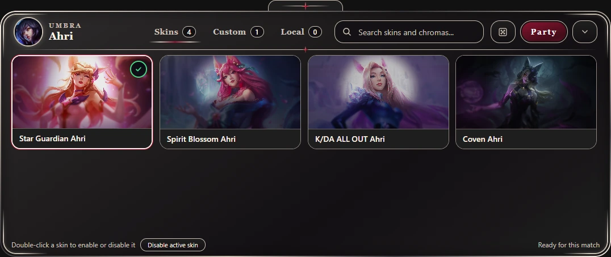
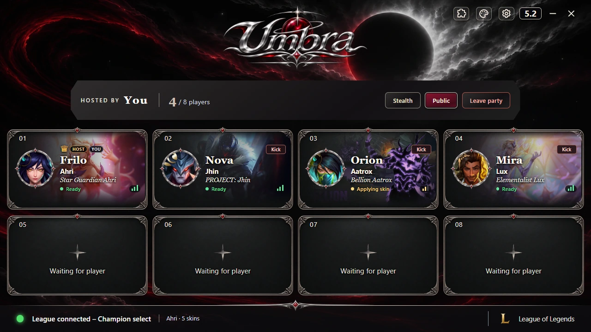
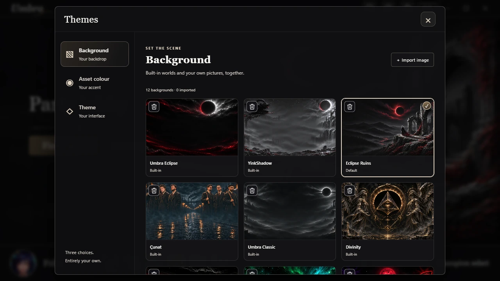
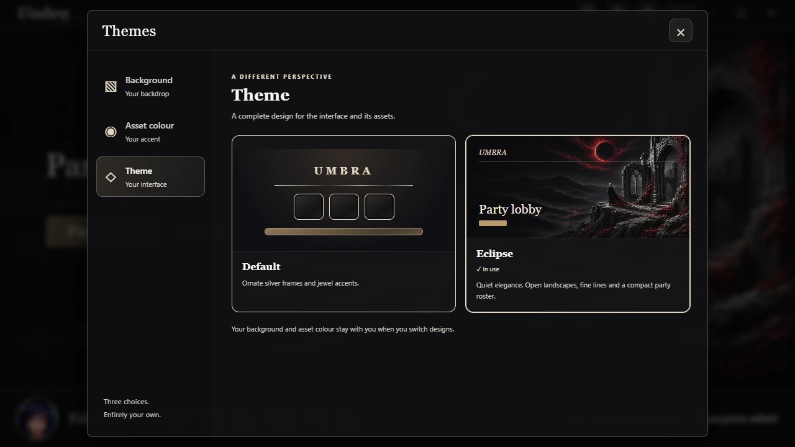
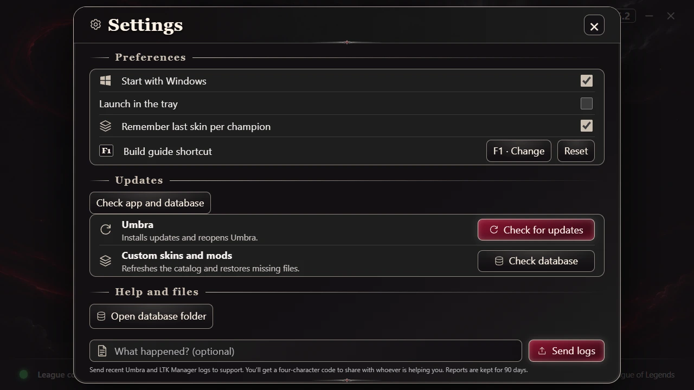

  

<strong>Your champion. Your style. Your party.</strong> 
Riot skins, chromas and custom looks for League of Legends, ready from champion select.

  
  
  

## A new look, a familiar game

| What you want | What Umbra brings |
| :--- | :--- |
| **Pick your look** | Browse Riot skins and chromas, search by name, or roll a random pick in the champion-select drawer. |
| **Go custom** | Use the custom catalogue, browse Divine Skins, add your own `.fantome` / `.modpkg` packages, and keep optional custom mods enabled across matches. |
| **Bring your friends** | Create a party or browse **Find Party**, which refreshes whenever you open it and while it stays open. Coordinate supported picks, see preparation status, and use Stealth to hide your selections. If the host leaves, a remaining member takes over. |
| **Keep a guide nearby** | Press **F1** by default for the bundled ARAM Mayhem guide or themed MetaSRC builds in Arena, ARAM and Ranked. Builds already viewed on a MetaSRC page reopen quickly. |
| **Make it yours** | Personalize Umbra with built-in backgrounds or your own images and a custom asset colour with a live preview and eyedropper. Each background remembers its colour. |
| **Stay ready** | App updates wait for League and skin work to be idle. Separate database checks refresh custom content; Send logs gives you a four-character support code. |

<table>
  <tr>
    <td width="50%" align="center"><strong>Your backdrop</strong></td>
    <td width="50%" align="center"><strong>Your signature colour</strong></td>
  </tr>
  <tr>
    <td></td>
    <td></td>
  </tr>
</table>

Interface previews in the Umbra Default theme, with sample selections and party members. Click the smaller images to see the details.

## Start in three steps

1. **[Download Umbra for Windows](https://github.com/frilo369/Umbra/releases/latest/download/Umbra-Setup.exe).** This always downloads the latest full setup, including for a first installation. [See what's new and checksums](https://github.com/frilo369/Umbra/releases/latest).
2. **Run setup.** You'll need 64-bit Windows 10/11, League of Legends, and internet for any missing prerequisites. Setup installs WebView2 and LTK Manager when needed; LTK may ask for administrator permission and licence acceptance.
3. **Open Umbra before you queue.** In champion select, open the skin drawer and double-click a skin to enable it. For Party, one person chooses **Create Party**; friends use **Find Party** and search for the host's name.

Umbra itself runs with your normal Windows permissions. To update, use **Settings → Check for updates**, or install the latest full setup. Your settings and skin library are preserved.

Open **Themes** in the top-left toolbar to change your background, asset colour or interface design. **Settings** also lets you change the guide shortcut, remember your last skin per champion and launch quietly in the tray.

<strong>A few things worth knowing</strong>

**Who sees the skins?**  
Solo changes are local to your game and do not unlock purchases on your Riot account. Party coordinates supported picks between compatible Umbra clients. Private Local skins use a shareable stand-in for friends, rather than transferring your private package.

**Have your own packages?** 
Open **Local Skins** from Custom Mods, then put your `.fantome` or `.modpkg` file in its champion's folder. Umbra keeps its own settings and library separate from other skin apps.

**What about Windows warnings?**  
Current releases are unsigned, so Windows or antivirus software may warn. Download only from this repository's Releases and compare the supplied SHA-256 checksums. A checksum is not a publisher signature or a guarantee of safety; report detections rather than disabling protection.

**Need help?**  
Choose **Settings → Send logs**, optionally add what happened, then give the four-character report code to the person helping you. This uploads a redacted Umbra and LTK Manager log report only when you click; reports are kept for 90 days. [Open an issue](https://github.com/frilo369/Umbra/issues) with your Umbra version and what happened.

   
  Download, run setup, and open Umbra.

---

Built by <a href="https://github.com/frilo369">FrYiLo</a> · Independent software, not affiliated with or endorsed by Riot Games. 
League of Legends and its artwork belong to Riot Games. Third-party modifications carry risk; no Riot approval or ban-free guarantee is claimed.

